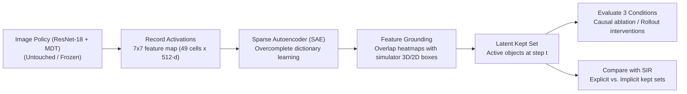

# Mechanistic Interpretability with Object Sets for Robot Policies

> **Seminar & Praktikum · Intuitive Robots Lab (KIT)**  
> **Topic 2:** Mechanistic Interpretability with Object Sets (Sparse Autoencoders)  
> **Group 4:** Allen & Luca  
> **Repository:** [officiallygod/Mechanistic-Interpretability-for-SIR](https://github.com/officiallygod/Mechanistic-Interpretability-for-SIR)

---

## 1. Project Overview

In robot manipulation, object-centric policies like **SIR** (*Structured Image Representations for Explainable Robot Learning*, CVPR 2026) select an explicit subset of objects (the "kept set" $K$) and claim intrinsic explainability. However, the companion ICLR 2027 analysis (*"Analyzing When a Learned Subset of Objects Explains a Robot Policy"*) reveals that explicit in-loop subset selection often suffers from information leaks, saturated budgets, and performance drops once leaks are sealed.

**Our Core Research Question:**
> *"Does a robot policy trained purely on pixels (without any explicit object selection) form an implicit, latent 'kept set' inside its representations?"*

Using **Sparse Autoencoders (SAEs)** from mechanistic interpretability, we untangle the intermediate feature representations of an untouched vision-based policy (e.g. ResNet-18 + MDT) into monosemantic features, ground them to scene objects using simulator bounding boxes, and evaluate the emergent latent kept set against the three foundational criteria:
1. **Discovery (D-C):** Did the model discover these object representations without explicit object-level supervision?
2. **Removal (R-C):** Do excluded objects truly have zero influence on the action when corresponding SAE features are ablated?
3. **Consequence (C-C):** Does ablating or preserving the discovered latent set causally impact task success compared to matched random ablations?

---

## 2. Methodology & Pipeline



1. **Policy Rollouts & Activation Recording:** Extract the $7 \times 7 \times 512$ feature map before global pooling in the ResNet-18 vision backbone during policy execution.
2. **SAE Training:** Train an overcomplete Sparse Autoencoder on these activation vectors to decouple superposition into sparse, interpretable features.
3. **Spatial Grounding & Labeling:** Map active SAE features back to spatial receptive fields and intersect them with simulator object bounding boxes/segmentation masks.
4. **Causal Intervention & Evaluation:** 
   - Test **Discovery** (unsupervised emergence).
   - Test **Removal** (zeroing out excluded features during rollout).
   - Test **Consequence** (task success retention vs. random feature ablations).
5. **Comparison:** Contrast the latent kept set with SIR's explicit kept set to verify whether the policy learns human-expected objects or exploits dataset biases (e.g., positional biases, spurious correlations).

---

## 3. Project Structure

```
SIR/                                     # Parent workspace directory
├── SIR_Model/                           # Upstream SIR repository (Intuitive Robots Lab)
└── Mechanistic-Interpretability-for-SIR/ # This Git repository (Group 4)
    ├── .env                             # Local secrets & API keys (git-ignored)
    ├── .gitignore                       # Ignore weights (*.pth), caches, logs, .env
    ├── README.md                        # Project documentation & roadmap
    ├── configs/                         # Hydra experiment configs
    ├── notebooks/                       # Exploratory analysis & SAE visualizations
    └── src/                             # Mechanistic interpretability & SAE modules
        ├── activation_recorder.py       # Hook & cache intermediate layer activations
        ├── sae.py                       # Sparse Autoencoder architecture & training
        ├── grounding.py                 # Feature-to-object spatial alignment
        └── causal_eval.py               # Interventions (Discovery, Removal, Consequence)
```

---

## 4. Setup & Collaboration

This repository serves as the shared workspace root for Group 4.

- Remote origin is configured with SSH: `git@github.com:officiallygod/Mechanistic-Interpretability-for-SIR.git`
- To push updates:
  ```bash
  git add <files>
  git commit -m "Your descriptive commit message"
  git push origin main
  ```
- To pull updates from teammates:
  ```bash
  git pull origin main
  ```
