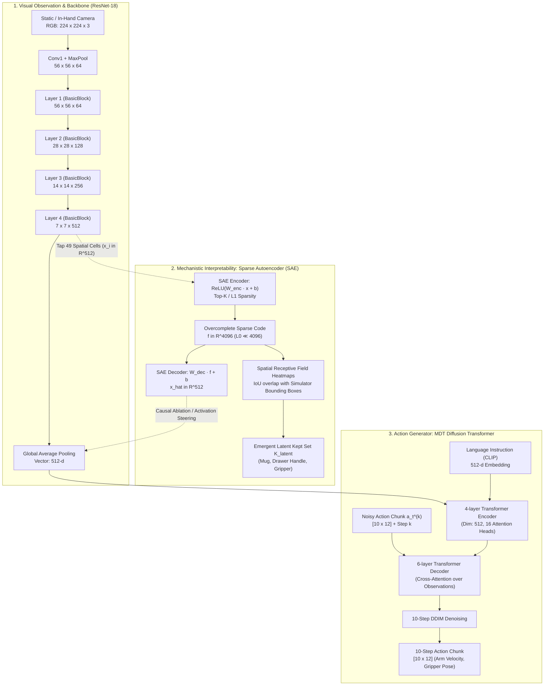

# Mechanistic Interpretability with Object Sets for Robot Policies

[](https://officiallygod.github.io/Mechanistic-Interpretability-for-SIR/)
[](https://www.python.org/)
[](https://pytorch.org/)
[](https://intuitive-robots.net/)

> **Seminar & Praktikum:** Explainable Object Sets for Robot Policies  
> **Topic 2:** Mechanistic Interpretability with Object Sets (Sparse Autoencoders)  
> **Team (Group 4):** Allen & Luca  
> **Supervisor:** Paul Mattes  
> **Documentation Portal:** [https://officiallygod.github.io/Mechanistic-Interpretability-for-SIR/](https://officiallygod.github.io/Mechanistic-Interpretability-for-SIR/)

---

## 1. Project Motivation & Research Question

In robot imitation learning, two paradigms currently exist:
1. **Explicit Object-Centric Policies (e.g. [SIR](https://github.com/intuitive-robots/SIR_Model)):** The visual scene is parsed into an explicit scene graph of objects. A selector prunes the graph down to an explicit "kept set" $K$ and claims intrinsic explainability. However, the companion ICLR 2027 analysis shows that explicit in-loop subset selections suffer from subtle leakage paths (e.g., softmax denominators normalizing over all nodes, survivor score weighting, presence counts) and often fail to simultaneously satisfy *Discovery*, *Removal*, and *Consequence*.
2. **End-to-End Image Policies (Pixel Baselines):** An image encoder (ResNet-18) processes the entire visual frame directly into a diffusion action generator (MDT). These policies achieve strong performance but remain opaque black boxes.

### The Central Question:
> **"Does a robot policy trained purely on pixels (without any explicit object selection) form an implicit, latent 'kept set' of objects inside its intermediate representations?"**

Instead of enforcing an artificial graph bottleneck, we inspect the untouched ResNet-18 representations using **Sparse Autoencoders (SAEs)** from mechanistic interpretability, ground the active features to physical objects in the simulator, and test the emergent latent set against the three foundational criteria.

---

## 2. Methodology & Architecture



### The 6-Step Protocol:
1. **Run Rollouts with Trained Image Policy:** Execute an untouched ResNet-18 + MDT policy and record the $7 \times 7 \times 512$ feature map at `layer4` before global average pooling.
2. **Train a Sparse Autoencoder (SAE):** Train an overcomplete dictionary ($M = 4096$, $8\times$ expansion) with Top-K or $L_1$ sparsity on these activation vectors to disentangle polysemantic superposition into monosemantic features.
3. **Label Features via Spatial Grounding:** Map active features across the $7 \times 7$ grid into 2D heatmaps and compute IoU against simulator ground-truth object bounding boxes.
4. **Form the Latent Kept Set ($K_{latent}$):** Identify the specific set of objects whose grounded features are actively firing at each step.
5. **Causal Intervention & Condition Testing:** Clamping or zeroing out features during rollout to test *Discovery*, *Removal*, and *Consequence*.
6. **Benchmark Against SIR:** Contrast $K_{latent}$ with SIR's explicit kept set to verify whether the policy learns human-expected objects or exploits dataset biases (e.g., positional biases, background shortcuts).

---

## 3. The Three Evaluation Criteria

| Condition | Core Question | Experimental Verification | Status |
| :--- | :--- | :--- | :--- |
| **Discovery (D-C)** | Did the model discover these objects on its own, or was it imposed by annotations? | Permutation test: The pixel policy is trained without any object supervision or bounding-box loss, passing by construction. We measure whether emergent features align with task-critical objects above chance. | **Measured** |
| **Removal (R-C)** | Do excluded objects truly have zero influence on the downstream action? | Causal feature ablation: Zero out SAE features corresponding to excluded objects ($f_j = 0$), reconstruct $\hat{x}$, and verify action invariance during closed-loop rollout. | **Measured via Ablation** |
| **Consequence (C-C)** | Does the selection matter beyond a random subset of the same size? | Closed-loop policy evaluation: Test whether ablating $K_{latent}$ causes task failure compared to matched random feature ablations. | **Measured on Success** |

---

## 4. Repository Structure

```
Mechanistic-Interpretability-for-SIR/
├── .github/workflows/
│   └── deploy-pages.yml       # Automated GitHub Pages CI/CD deployment
├── docs/                      # Interactive GitHub Pages documentation
│   ├── index.html             # Academic project portal with interactive diagrams
│   ├── .nojekyll              # Disables Jekyll processing on GitHub Pages
│   └── architecture_deep_dive.md # Detailed tensor dimensions & layer specifications
├── papers/                    # Foundational research literature
│   ├── CVPR_graph_paper_2026.pdf # SIR: Structured Image Representations (CVPR 2026)
│   ├── Closing_the_loop_SIR_ICLR_2027-1.pdf # Analysis of subset explanations (ICLR 2027)
│   └── README.md              # Context & literature summaries
├── notes/                     # Team meeting logs and discussion points
│   └── questions_to_paul.md   # Open research questions for supervisor
├── src/                       # Core Mechanistic Interpretability implementation
│   ├── __init__.py            # Package root
│   ├── activation_recorder.py # PyTorch forward hooks for ResNet-18 layer4 activations
│   ├── sae.py                 # Top-K / L1 Sparse Autoencoder model
│   ├── grounding.py           # Spatial heatmap projection & bounding-box IoU
│   └── causal_intervention.py # Feature clamping & closed-loop ablation hooks
├── SIR_Model/                 # Upstream SIR model & environment benchmarks
├── .env                       # Local environment variables & API keys (git-ignored)
├── .gitignore                 # Exclusion rules for weights (*.pth), caches, and data
└── README.md                  # Project overview & roadmap (this file)
```

---

## 5. Development & GitHub Pages Deployment

### Enabling GitHub Pages:
The repository includes an automated GitHub Action (`.github/workflows/deploy-pages.yml`) that publishes `docs/` to GitHub Pages on every push to `main`.

To ensure GitHub Pages is enabled in your repository:
1. Go to **Settings** $\to$ **Pages** in the GitHub repository.
2. Under **Build and deployment** $\to$ **Source**, select **GitHub Actions**.
3. Pushing any update to `main` will automatically build and deploy the interactive documentation portal!

### Local Collaboration:
```bash
# Pull latest changes from teammates
git pull origin main

# Stage and commit new changes
git add .
git commit -m "feat: description of work"
git push origin main
```
