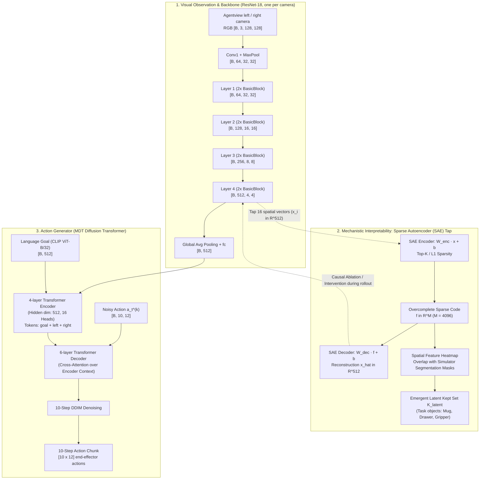

# MIS: Policy Architecture & Mechanistic Interpretability Tap

> **Project:** MIS (Mechanistic Interpretability for SIR)
> **Links:** [🌐 Documentation Portal](index.html) • [🗺️ SIR Code Mind Map](sir_code_mindmap.md) • [📊 Presentation Slides](https://docs.google.com/presentation/d/1mFDo7Pkut4FRN9KIvGs0BECcrez3ElA9oxkdym2P1z8/edit?usp=sharing) • [🧠 Miro Board](https://miro.com/welcomeonboard/Q3BMR0hTZ09UditVS2hqUU1zZGRBZ0RnTlVVRGc4OGtyYzZieUkycDkxakRtYm5YWnZSZ0lodTQ2N0o4Nys4bG5ra0xHMEMrSVpaVTFCVkNPYllQd21yRE5KcTdYZDZxNXNFdFF3Mnd1ZWVHV1VHSFdxN25DNEtCOW1uVXdjNnp3VHhHVHd5UWtSM1BidUtUYmxycDRnPT0hdjE=?share_link_id=911869718076)
> **Codebase version:** `SIR_Model/` = [intuitive-robots/sir](https://github.com/intuitive-robots/sir) @ `49321d0`



This document details the neural architecture of the **image-only policy** in the `SIR_Model` codebase and how the **Mechanistic Interpretability (Topic 2)** pipeline taps into it to discover and evaluate implicit object sets. For a map of the whole codebase (graph encoder, sparsification, managers, rollouts), see the [SIR Code Mind Map](sir_code_mindmap.md).

**Running the image-only policy.** The upstream default config is the *graph* policy. The image baseline needs:

```bash
python main.py manager.image_modalities=[left,right] manager.graph_modalities=[]
```

---

## 1. Visual Perception Backbone: ResNet-18

Each camera gets its own ImageNet-pretrained **ResNet-18** (`networks.vision_encoder.cnn.Multi_CNN` → `CNN`), with `fc` replaced by `Linear(512, 512)`. Inputs are 128 × 128 RGB, normalised with ImageNet mean/std (`envs/robocasa/kitchen.py`, `dataloader/datasets.py`).

```
Input Image (RGB) [B, 3, 128, 128]
        │
   Conv1 + MaxPool [B, 64, 32, 32]
        │
   Layer 1 (2x BasicBlock) [B, 64, 32, 32]
        │
   Layer 2 (2x BasicBlock) [B, 128, 16, 16]
        │
   Layer 3 (2x BasicBlock) [B, 256, 8, 8]
        │
   Layer 4 (2x BasicBlock) [B, 512, 4, 4]  ◄─── [ACTIVATION TAP POINT]
        │
   Global Average Pooling [B, 512, 1, 1]
        │
   fc: Linear(512, 512) [B, 512] ─────────────► To Action Generator (one token per camera)
```

### The Activation Tap Point:
* **Module path:** `method.vision_encoder.models['<cam>'].vision_model.layer4`, where `<cam>` ∈ {`left`, `right`, `inhand`}. `Base_Method` is not an `nn.Module`, so hooks must be registered on `method.vision_encoder` or deeper.
* **Spatial Feature Map:** the output of `layer4` is a $4 \times 4$ grid of activations with channel dimension $C = 512$.
* **Receptive Field:** each of the $16$ spatial cells corresponds to a $32 \times 32$ pixel patch on the 128 × 128 input ($128 / 4 = 32$). Its effective receptive field covers a larger context.
* **Why Tap Here?** This is the final layer before spatial information is collapsed by global average pooling. Objects are still spatially localised across the $4 \times 4$ grid, although the grid is coarse: a small object like a mug handle may occupy less than one cell.
* **When it fires:** `Diffusion.preprocess_batch` runs the ResNet once per policy call. During rollouts that is **once per 10-step action chunk** (`envs/robocasa/kitchen.py`, or `envs/robocasa/parallel/policy_server.py` for the default parallel evaluation).

---

## 2. Mechanistic Interpretability: Sparse Autoencoder (SAE) Tap

In deep networks, individual neurons are polysemantic due to **superposition**: they represent multiple unrelated concepts in non-orthogonal linear combinations. The SAE untangles this dense representation into monosemantic, interpretable units.

```
Spatial Cell Vector x_i ∈ ℝ⁵¹²
        │
        ▼
   Encoder: f(x) = ReLU(W_enc · x_i + b_enc)  ──► Sparse Code f ∈ ℝᴹ (M = 4096, L₀ ≪ M)
        │
        ▼
   Decoder: x̂_i = W_dec · f(x) + b_dec         ──► Reconstructed Vector x̂_i ∈ ℝ⁵¹²
```

### Specifications:
* **Dictionary Expansion Factor:** $8\times$ (from $d = 512$ to $M = 4096$) or $16\times$ ($M = 8192$).
* **Sparsity Enforcement:** Top-K activation or $L_1$ penalty ($\mathcal{L}_{SAE} = \|x - \hat{x}\|_2^2 + \lambda \|f\|_1$).
* **Training data per policy call:** 16 vectors per camera (32 for `left` + `right`).
* **Spatial Grounding:**
  1. For each active feature $j \in \{1, \dots, M\}$, record its firing intensity across all 16 cells $(u, v) \in \{1..4\} \times \{1..4\}$.
  2. Build the spatial heatmap $H_j(u, v)$ and map it to camera pixel space.
  3. Compare it with the simulator's per-pixel segmentation masks (`obs['robot0_agentview_{left,right}_segmentation_class']`, the same source SIR uses to build its scene graphs), e.g. by pooling each object mask to the 4 × 4 grid.
  4. Features with high selectivity for a specific object are assigned that object's label. We reuse SIR's object vocabulary (`OBJECT_NAMES_IMAGES` in `utils/generate_graph_dataset_robocasa.py`).
* **Latent Kept Set ($K_{latent}$):** the set of objects whose associated SAE features are active at a policy call.

---

## 3. Action Generator: Multimodal Diffusion Transformer (MDT)

The action policy is **MDT** (`networks.action_generator.mdt.MDT`), a diffusion model over action chunks:

```
Inputs:
  ├── Visual Tokens: one pooled ResNet-18 feature per camera [B, 1, 512] each (obs_window = 1)
  ├── Language Goal: CLIP ViT-B/32 text embedding [B, 1, 512]
  └── Noisy Action Chunk: a_t^{(k)} [B, 10, 12] + noise level sigma
```

### Transformer Architecture Details (`configs/method/action_generator/mdt.yaml`):
* **Encoder:** 4 Transformer layers, 16 attention heads, embedding dimension 512, over `[goal | left | right]` tokens.
* **Decoder:** 6 Transformer layers. Self-attention runs over the action tokens, cross-attention over the encoder context, and FiLM conditions on the sigma embedding.
* **Action Window:** 10 timesteps into the future (action chunking), executed open-loop before the next policy call.
* **Action Dimension:** 12 (the dataset's `eef` action).
* **Denoising Process:**
  * Karras-style preconditioning in training, with log-logistic sigma sampling. DDIM with 10 sampling steps at inference.
  * Noise schedule: exponential ($\sigma_{min} = 0.001$, $\sigma_{max} = 80$, $\sigma_{data} = 0.5$).

---

## 4. Causal Intervention & Hypothesis Testing (The 3 Conditions)

With this architecture, we perform causal interventions to test the three ICLR conditions:

| Condition | Experimental Mechanism | What It Proves |
| :--- | :--- | :--- |
| **Discovery** | Measure alignment between $K_{latent}$ and task-relevant objects (`RELEVENT_NODES` in `utils/generate_graph_dataset_robocasa.py`) without supplying any object supervision during training. | Whether object modularity emerges spontaneously inside the end-to-end vision policy. |
| **Removal** | Zero out the active SAE features associated with excluded objects ($f_j = 0$), reconstruct $\hat{x}$, and inject it at `layer4` during rollout. | Whether the policy disregards excluded objects when their latent features are ablated. |
| **Consequence** | Compare task success under task-object feature ablation vs. random feature ablation of the same size. This mirrors SIR's own `trainer.graph_eval_mode=random` control. | Whether the discovered latent set causally determines task success or is merely epiphenomenal. |
