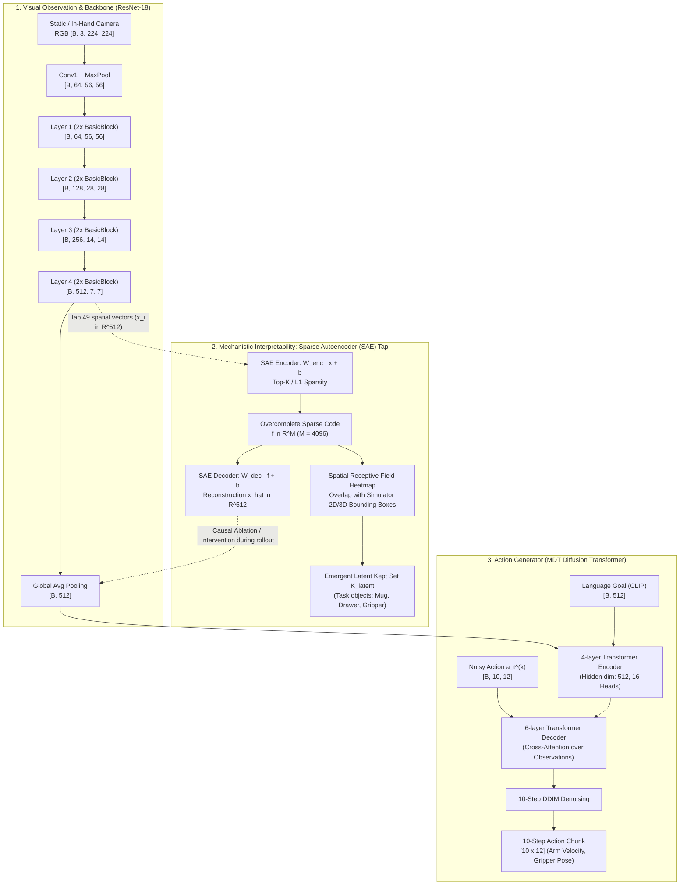

# Policy Architecture & Mechanistic Interpretability Tap



This document details the exact neural architecture currently deployed in the `SIR_Model` codebase and how the **Mechanistic Interpretability (Topic 2)** pipeline taps into it to discover and evaluate implicit object sets.

---

## 1. Visual Perception Backbone: ResNet-18

The image baseline uses a standard ImageNet-pretrained **ResNet-18** (`networks.vision_encoder.cnn.CNN`):

```
Input Image (RGB) [B, 3, 224, 224]
        │
   Conv1 + MaxPool [B, 64, 56, 56]
        │
   Layer 1 (2x BasicBlock) [B, 64, 56, 56]
        │
   Layer 2 (2x BasicBlock) [B, 128, 28, 28]
        │
   Layer 3 (2x BasicBlock) [B, 256, 14, 14]
        │
   Layer 4 (2x BasicBlock) [B, 512, 7, 7]  ◄─── [ACTIVATION TAP POINT]
        │
   Global Average Pooling [B, 512, 1, 1]
        │
   Linear Projection [B, 512] ───────────────► To Action Generator
```

### The Activation Tap Point:
* **Spatial Feature Map:** The output of `layer4` preserves a $7 \times 7$ spatial grid of activations with channel dimension $C = 512$.
* **Receptive Field:** Each of the $49$ spatial cells corresponds to an approximately $32 \times 32$ pixel patch on the input image ($224 / 7 = 32$), with an effective receptive field covering a larger contextual region.
* **Why Tap Here?** This is the final layer before spatial information is collapsed via global average pooling. Objects are still spatially localized across the $7 \times 7$ grid.

---

## 2. Mechanistic Interpretability: Sparse Autoencoder (SAE) Tap

In deep networks, individual neurons are polysemantic due to **superposition** (representing multiple unrelated concepts in non-orthogonal linear combinations). The SAE untangles this dense representation into monosemantic, interpretable units.

```
Spatial Cell Vector x_i ∈ ℝ⁵¹²
        │
        ▼
   Encoder: f(x) = ReLU(W_enc · x_i + b_enc)  ──► Sparse Code f ∈ ℝᴹ (M = 4096, L₀ ≪ M)
        │
        ▼
   Decoder: x̂_i = W_dec · f(x) + b_dec         ──► Reconstructed Vector x̂_i ∈ ℝ⁵¹²
```

### Specifications:
* **Dictionary Expansion Factor:** $8\times$ (from $d = 512$ to $M = 4096$) or $16\times$ ($M = 8192$).
* **Sparsity Enforcement:** Top-K activation or $L_1$ penalty ($\mathcal{L}_{SAE} = \|x - \hat{x}\|_2^2 + \lambda \|f\|_1$).
* **Spatial Grounding:**
  1. For each active feature $j \in \{1, \dots, M\}$, record its firing intensity across all 49 cells $(u, v) \in \{1..7\} \times \{1..7\}$.
  2. Compute the spatial heatmap $H_j(u, v)$ and map it to camera pixel space.
  3. Compute intersection-over-union (IoU) with ground-truth simulator bounding boxes (e.g., `drawer_handle`, `mug`, `gripper`, `counter`).
  4. Features with high selectivity for a specific bounding box are assigned that object's semantic label.
* **Latent Kept Set ($K_{latent}$):** The set of objects whose associated SAE features are active at timestep $t$.

---

## 3. Action Generator: Multimodal Diffusion Transformer (MDT)

The action policy is driven by **MDT** (`networks.action_generator.mdt.MDT`), a diffusion model operating on action chunks:

```
Inputs:
  ├── Visual Token: ResNet-18 pooled feature [B, 1, 512]
  ├── Language Goal: CLIP text embedding [B, 1, 512]
  └── Noisy Action Chunk: a_t^{(k)} [B, 10, 12] + Diffusion Timestep k
```

### Transformer Architecture Details:
* **Encoder:** 4 Transformer layers, 16 attention heads, hidden dimension 512, dropout 0.1.
* **Decoder:** 6 Transformer layers with conditional cross-attention over observation tokens (vision + language).
* **Action Window:** 10 timesteps into the future (action chunking).
* **Action Dimension:** 12-DoF (RoboCasa: arm joint/cartesian velocity, gripper pose, jaw status).
* **Denoising Process:**
  * DDIM / EDM formulation with 10 sampling steps during inference.
  * Noise schedule: Exponential ($\sigma_{min} = 0.001$, $\sigma_{max} = 80$, $\sigma_{data} = 0.5$).

---

## 4. Causal Intervention & Hypothesis Testing (The 3 Conditions)

With this architecture, we perform causal interventions to test the three ICLR conditions:

| Condition | Experimental Mechanism | What It Proves |
| :--- | :--- | :--- |
| **Discovery** | Measure alignment between $K_{latent}$ and task-relevant objects without supplying any object supervision during training. | Proves whether object modularity emerges spontaneously inside the end-to-end vision policy. |
| **Removal** | Zero out active SAE features associated with excluded objects ($f_j = 0$), reconstruct $\hat{x}$, and inject into the network during rollout. | Verifies whether the policy strictly disregards excluded objects when their latent features are ablated. |
| **Consequence** | Compare task success under task-object feature ablation vs. random feature ablation of the same size. | Verifies whether the discovered latent set causally determines task success or is merely epiphenomenal. |
