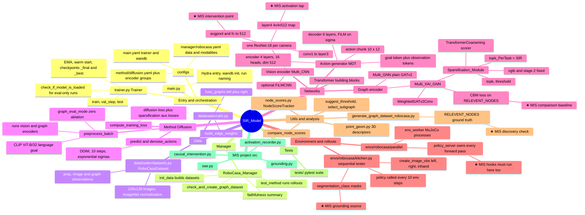
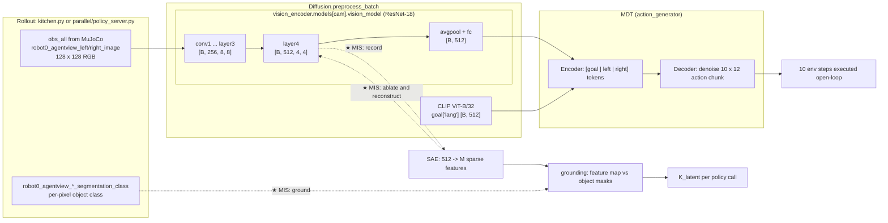

# SIR Code Mind Map

> **Project:** MIS (Mechanistic Interpretability for SIR)
> **Codebase:** [`SIR_Model/`](../SIR_Model/), vendored from [intuitive-robots/sir](https://github.com/intuitive-robots/sir) at commit `49321d0`
> **Purpose:** a map of the upstream SIR code, plus placeholders showing where, how and why our MIS components (activation recorder, SAE, grounding, causal intervention) plug into it.

Nodes marked **★ MIS** are our integration points. Everything else is upstream SIR code that we read but do not change.

---

## 1. The Mind Map

---

## 2. How one forward pass flows

The mind map lists the components. This diagram shows the order they run in for the **image-only policy**, which is the policy our topic studies.

Shape facts checked against the code:

| Fact | Value | Source |
|---|---|---|
| Camera resolution | 128 × 128 | `SIR_Model/envs/robocasa/utils.py:76`, `dataloader/datasets.py:193` |
| ResNet-18 `layer4` map | **4 × 4 × 512**, i.e. 16 cells of 32 × 32 px (128 / 32 = 4) | standard ResNet stride 32 |
| Image normalisation | ImageNet mean/std | `envs/robocasa/kitchen.py:67` |
| One ResNet per camera | separate weights for `left`, `right`, `inhand` | `networks/vision_encoder/cnn.py:14` |
| Tokens into the MDT | 1 goal token + 1 token per camera per obs step (`obs_window = 1`) | `networks/action_generator/mdt.py:311` |
| Policy call frequency | once per 10-step action chunk | `envs/robocasa/kitchen.py:191-200` |
| Image-only config | `manager.image_modalities=[left,right]`, `graph_modalities=[]` | `SIR_Model/robocasa_results.md` §2 |

> The upstream default config is the **graph** policy (`graph_modalities: [cropped_image_feature, bb_coordinates]`, `image_modalities: []`). Our image policy needs the overrides in the last row.

---

## 3. Component guide

### 3.1 Entry and orchestration

| Component | File | What it does |
|---|---|---|
| `main` | `SIR_Model/main.py` | Hydra entry point. Seeds, sets up wandb, instantiates manager and method, then calls `Trainer.start()`. |
| `Trainer` | `SIR_Model/trainer.py` | Training loop with EMA, validation, checkpointing (`_final` and `_best`), and `test()`, which calls `manager.test_method`. With `train_bool=false` it loads `trainer.model_path` and only evaluates. |
| Configs | `SIR_Model/configs/` | `main.yaml` (trainer, wandb), `manager/robocasa.yaml` (data, modalities, parallel eval), `method/diffusion.yaml` (optimizer, sampler) with groups `action_generator/`, `vision_encoder/`, `graph_encoder/`. |

### 3.2 Manager and data

| Component | File | What it does |
|---|---|---|
| `RoboCasa_Manager` | `SIR_Model/manager/robocasa_manager.py` | Owns datasets and environments. `test_method` picks the sequential or parallel tester and aggregates success and faithfulness. |
| `RoboCasaDataset` | `SIR_Model/dataloader/datasets.py` | Loads RoboCasa demos (`demo_gentex_im128_randcams.hdf5`), returning prop, image and graph observations plus the `eef` action. |
| Graph fusion | `SIR_Model/dataloader/utils.py` | `fuse_graphs` merges the left and right scene graphs into one graph per step. |

### 3.3 Method: `Diffusion`

`SIR_Model/method/diffusion.py`, which extends `method/base_method.py`. **`Base_Method` is not an `nn.Module`**: its sub-networks are attributes (`action_generator`, `vision_encoder`, `graph_encoder`, `language_encoder`).

- `preprocess_batch` encodes the language goal with CLIP and runs the vision and graph encoders. It returns `(state, action, goal)`. **This is where the ResNet runs, and so where our hook fires.**
- `compute_training_loss` adds the diffusion loss to the sparsification aux losses.
- `predict` runs DDIM sampling (10 steps) through the MDT.

### 3.4 Networks

| Component | File | Notes |
|---|---|---|
| `Multi_CNN` / `CNN` | `networks/vision_encoder/cnn.py` | torchvision ResNet-18 (ImageNet-pretrained), with `fc` replaced by `Linear(512, 512)`. `FiLMCNN` is the language-conditioned variant, off by default (`use_film: false`). |
| `SimpleImageEncoder` | `networks/vision_encoder/cnn.py` | Pretrained encoder for the graph's `cropped_image_feature` modality (weights in `trained_models/`). |
| `Multi_GNN` | `networks/graph_encoder/gnn.py` | Plain GATv2 stack with no selection. |
| `Multi_XAI_GNN` + `Sparsification_Module` | `networks/graph_encoder/gnn.py` | SIR's explicit selector. A FiLM transformer scores the nodes, then one of these strategies picks them: `topk_PerTask` (SIR), `topk`, `threshold`, `vgib`, `fixed`. Exposes `last_sparsification` (kept nodes and raw scores) after each forward pass. |
| `MDT` | `networks/action_generator/mdt.py` | Encoder over `[goal | observation tokens]` and a decoder that denoises the action chunk, conditioned on sigma. |

### 3.5 Environment and rollouts

| Component | File | Notes |
|---|---|---|
| `RoboCasaKitchenTester` | `envs/robocasa/kitchen.py` | Sequential rollouts. Builds the observation, calls `method.preprocess_batch` and `method.predict`, then executes 10 actions. |
| Parallel eval | `envs/robocasa/parallel/` | `env_worker.py` runs MuJoCo processes. `policy_server.py` is a thread in the main process that batches observations and owns **every** forward pass. On by default (`parallel_eval: True`, `num_envs: 10`). |
| Segmentation | `obs['robot0_agentview_{left,right}_segmentation_class']` | Per-pixel class masks from the simulator, already used to build SIR's graphs. This is our ground truth for feature grounding. |

### 3.6 Analysis utilities worth reusing

| Tool | File | Why it matters for us |
|---|---|---|
| `RELEVENT_NODES`, `get_num_relevant_nodes_per_task` | `utils/generate_graph_dataset_robocasa.py` | Hand-written task-relevant objects. Our reference for "did K_latent find the right objects". |
| `score_subgraph_faithfulness` | `utils/generate_graph_dataset_robocasa.py` | Precision, recall, F1 and Jaccard of a kept set against the relevant nodes. We can apply the same metric to K_latent. |
| `NodeScoreTracker` | `utils/node_scores.py` | Per-(task, object) score snapshots. A template for logging per-feature statistics. |
| `graph_eval_mode` (`full` / `random` / `zero`) | `trainer.py`, `method/diffusion.py` | SIR's own Consequence control (random subset of the same size). We mirror this with random SAE-feature ablations. |

---

## 4. MIS integration placeholders

Each block is a placeholder for our project. **Where** and **Why** are pre-filled from the code. Fill in the **How**, **Status** and **Open questions** as the work progresses.

### ★ 4.1 Image policy checkpoint

- **Where:** `trainer.model_path` in `SIR_Model/configs/main.yaml`; overrides `manager.image_modalities=[left,right] manager.graph_modalities=[]`
- **Why:** the topic asks for an image policy *without* object selection. Upstream's "Image only" baseline reaches 12.93 % mean success over 24 tasks (`SIR_Model/robocasa_results.md` §3).
- **How:** _TODO: train our own or get Paul's checkpoint? Which tasks: all 24 or a subset like `CloseDrawer`?_
- **Status:** _TODO_
- **Open questions:** _TODO_

### ★ 4.2 Activation recorder (`src/activation_recorder.py`)

- **Where:** a forward hook on `method.vision_encoder.models['left'].vision_model.layer4` (and `['right']`). Rollouts fire it from `Diffusion.preprocess_batch`, called in `envs/robocasa/kitchen.py:165` and in `envs/robocasa/parallel/policy_server.py:218`.
- **Why:** `layer4` is the last layer that still has spatial structure before `avgpool` collapses it.
- **How:** _TODO: record on the sequential or the parallel path? (The parallel server batches several envs per forward pass, so recorded rows must be split by `env_id`.) Also record offline from the dataset?_
- **Notes:**
  - The map is **4 × 4**, not 7 × 7, so each step gives 16 vectors in ℝ⁵¹² per camera.
  - `Base_Method` is not an `nn.Module`, so the hook has to be registered on `method.vision_encoder` (or deeper), not on `method`.
  - Two cameras means two ResNets with different weights. Use one SAE per camera, or a shared one? _TODO_
- **Status:** _TODO_

### ★ 4.3 Sparse autoencoder (`src/sae.py`)

- **Where:** offline, trained on the recorded `layer4` vectors. It does not touch `SIR_Model/`.
- **Why:** it splits superposed ResNet channels into sparse, ideally monosemantic features that we can label with objects.
- **How:** _TODO: dictionary size M (4096 = 8× on 512), Top-K vs L1, K, training-set size, dead-feature handling._
- **Metrics:** reconstruction MSE, L0, fraction of dead features, and **downstream success with the SAE spliced in**. _TODO: targets_
- **Status:** _TODO_

### ★ 4.4 Grounding (`src/grounding.py`)

- **Where:** feature maps from 4.3, matched against `obs['robot0_agentview_{left,right}_segmentation_class']` (rollout) or the segmentation stored in the dataset.
- **Why:** to label each SAE feature with the object(s) it fires on, and to test whole object vs part vs pixel granularity.
- **How:** _TODO: per-pixel masks are more precise than bounding boxes. Pool each object mask to the 4 × 4 grid (fraction of each 32 × 32 cell covered by the object), then score each feature against it._
- **Name mapping:** reuse SIR's object vocabulary (`OBJECT_NAMES_IMAGES`, `NODE_ALIASES` in `utils/generate_graph_dataset_robocasa.py`) so that K_latent and SIR's kept set use the same names.
- **Status:** _TODO_

### ★ 4.5 Latent kept set K_latent

- **Where:** computed once per policy call, i.e. per 10-step action chunk.
- **Why:** it is the implicit counterpart of SIR's `last_sparsification[mod]['sampled_nodes']`.
- **How:** _TODO: activation threshold per feature, and how a set of active features maps to a set of objects._
- **Status:** _TODO_

### ★ 4.6 Causal intervention (`src/causal_intervention.py`)

- **Where:** a hook on `layer4` that replaces its output with an SAE reconstruction in which selected features are zeroed. It then flows through `avgpool`, `fc` and the MDT as usual.
- **Why:** to test Removal (excluded objects have no influence) and Consequence (task-object ablation vs a matched random ablation, like SIR's `graph_eval_mode=random`).
- **How:** _TODO: add the SAE error term `x - x̂` back so that only the ablation changes the output. Hook on/off via config. Which tasks and how many rollouts (`trainer.eval_n_times`)?_
- **Status:** _TODO_

### ★ 4.7 Comparison with SIR

- **Where:** SIR checkpoints evaluated with `method/graph_encoder=xai_gnn` (topk_PerTask + CBM). Kept sets are read from `last_sparsification` and node-score snapshots under `<run>/node_scores/`.
- **Why:** the final research question asks whether the implicit set matches SIR's explicit set and `RELEVENT_NODES`.
- **How:** _TODO: per-task Jaccard between K_latent and SIR's kept set, plus precision@k against `RELEVENT_NODES` (see `utils/compare_node_scores.py`)._
- **Status:** _TODO_

---

## 5. Where to read next

- `SIR_Model/overview.md`: upstream's detailed design notes (sparsification strategies, VGIB, node scores, evaluation knobs).
- `SIR_Model/robocasa_results.md`: headline numbers for SIR, VGIB and Image-only.
- [`architecture_deep_dive.md`](architecture_deep_dive.md): tensor-level view of the image policy and the SAE tap.
